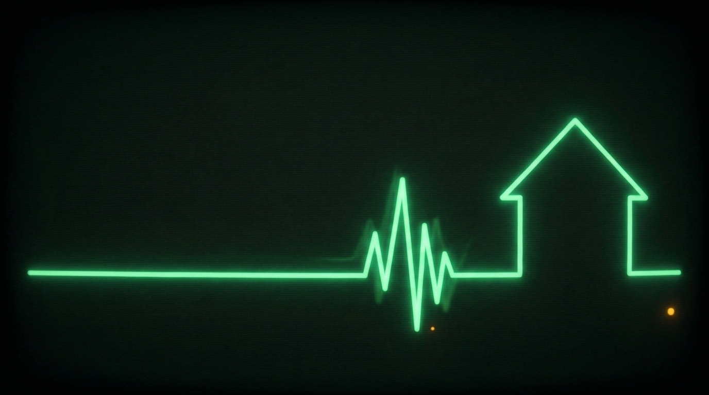

  

### phosphor house

Independent software lab & studio building sharp developer tools, creative engines, and interactive systems that glow a little too green.

- **Developer Tools & Telemetry** — Local-first observability, runtime diagnostics, and fast command-line tooling built for daily engineering.
- **Interactive Systems & Games** — Tactile simulations and systems-driven satire, including **BUY THE RUMOR** *(Sell the News)*.
- **Creative & Rendering Tooling** — Procedural shaders, 2D/3D stylization pipelines, and high-contrast visual craft.

> *Sharp tools. Strange worlds. High contrast.*
